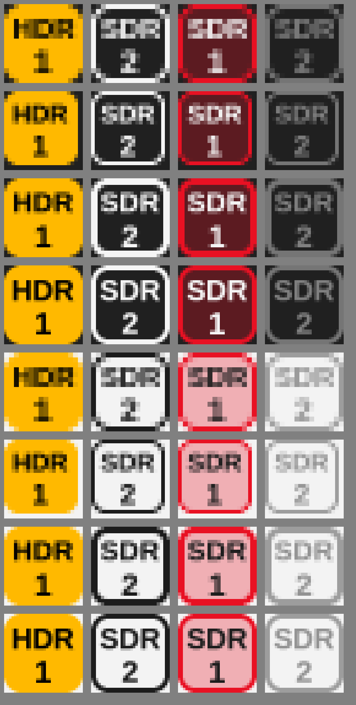

# Nitpick

**Per-monitor HDR control for Windows.** Nitpick is a small tray app that shows and controls HDR **per monitor**. It merges
[HDRTray](https://github.com/res2k/HDRTray) (tray status icon, Win11 24H2 HDR
APIs, autostart) with [HDRToggler](https://github.com/GiulioSamp/HDRToggler)
(per-monitor toggling) and adds a per-monitor **HDR lock**.

Native C++/Win32: one ~1 MB `.exe`, no .NET runtime, no installer.



## What it does

**One tray icon per display**, each showing that display's own state:

| Icon | Meaning |
|---|---|
| Gold badge, **HDR** | HDR is on |
| Outlined badge, **SDR** | HDR is off (click to turn it on) |
| Red badge, **SDR** | HDR is **locked off** |
| Faded badge, **SDR** | This display can't do HDR |

The number under the label is the display number, counted left to right.
Hover an icon to see the monitor's name.

**Toggling (1–2 clicks)**
- Left-click a display's icon to toggle HDR on that display. That's 1 click.
- Right-click any icon, then click a display in the menu to toggle it. That's 2 clicks.
- The menu also has *HDR on for all unlocked displays* and *HDR off for all displays*.

**Locking HDR off**
- Right-click, then tick **Lock HDR off** under a display. That's 2 clicks.
- While a lock is active:
  - **Win+Alt+B** is intercepted before Windows sees it. It still toggles HDR
    on your *unlocked* displays, so the shortcut keeps working without touching
    the locked one.
  - Anything else that turns HDR on for that display (the Settings toggle, a
    game, another tool) is switched back off right away. The app watches for
    display changes and re-checks every second.
- Locks are saved per physical monitor and survive reboots.

**Other**
- *Identify displays* briefly shows a big number plus the HDR status on each screen.
- *Start with Windows* (needed for locks to be enforced after you log in).
- *Show icons for non-HDR displays* can be unticked to hide the faded icons.
- Follows the light/dark taskbar theme and DPI scaling.

## Setup

1. Download the latest zip from [Releases](../../releases), then put `NitpickHDR.exe` somewhere permanent, for example `C:\Tools\Nitpick\`, and run it.
   The exe is unsigned, so SmartScreen may warn you: choose *More info → Run anyway*.
2. **Windows 11 hides new tray icons in the overflow (^) menu.** To keep them visible,
   open *Settings → Personalization → Taskbar → Other system tray icons* and switch
   **Nitpick** on. You may see one entry per display.
3. Right-click an icon and tick **Start with Windows**.

## Limitations

- The lock is enforced by this app, not by the monitor or driver. If something
  other than Win+Alt+B turns HDR on, the display may flicker into HDR for up to
  a second before it's switched back. The same happens if you press Win+Alt+B
  while an *administrator* window has focus, because Windows doesn't send keys
  from elevated windows to normal apps. If the app isn't running, nothing is
  locked.
- A truly permanent, driver-level block would mean removing the HDR data block
  from the monitor's EDID (for example with CRU). This app deliberately doesn't
  edit the registry or drivers that way.
- Display numbers go left to right and may not match the numbers in Windows
  Settings. Use *Identify displays* to check.
- Requires Windows 10 1803+ or Windows 11. On Windows 11 24H2+ it uses the newer
  HDR APIs, which also behave correctly with Auto Color Management.

## Building

The project uses CMake with either MSVC or MinGW.

```bat
cmake -B build -A x64
cmake --build build --config Release
```

To cross-compile from Linux with MinGW-w64:

```sh
cmake -B build -DCMAKE_SYSTEM_NAME=Windows \
      -DCMAKE_CXX_COMPILER=x86_64-w64-mingw32-g++-posix \
      -DCMAKE_RC_COMPILER=x86_64-w64-mingw32-windres -DCMAKE_BUILD_TYPE=Release
cmake --build build
```

Add `-DNITPICK_VERSION=1.2.3` to the configure step to stamp a version into the exe.

## Releases

GitHub Actions (`.github/workflows/build.yml`) builds the exe on every push to
`main`; you can download it from the run's page in the **Actions** tab.

To publish a release, push a version tag:

```sh
git tag v1.0.0
git push origin v1.0.0
```

The workflow then builds the exe with that version and creates a GitHub
Release containing `NitpickHDR-1.0.0-win64.zip`, the bare exe and
`SHA256SUMS.txt`. Release notes are generated from the commits since the
previous tag. A tag with a suffix, such as `v1.1.0-beta.1`, is published as a
pre-release.

Developer aid: `NitpickHDR.exe --dump-icons C:\some\folder` writes every icon variant as a `.bmp`.

## Settings storage

- `HKCU\Software\NitpickHDR`: options
- `HKCU\Software\NitpickHDR\LockedDisplays`: locked monitors, keyed by device path
- `HKCU\Software\Microsoft\Windows\CurrentVersion\Run\NitpickHDR`: autostart

To remove everything, untick *Start with Windows*, exit the app, then delete
`HKCU\Software\NitpickHDR`.

## Credits and license

- HDR detection and switching logic is adapted from **HDRTray** by Frank Richter
  (GPL-3.0-or-later), which builds on Kodi (GPL-2.0-or-later).
- The per-monitor approach comes from **HDRToggler** by GiulioSamp (AGPL-3.0).

Because this is a combined work, Nitpick is released under the
**GNU AGPL-3.0-or-later** (see `LICENSE`). GPLv3 section 13 allows combining
GPLv3 code with AGPLv3 code.
